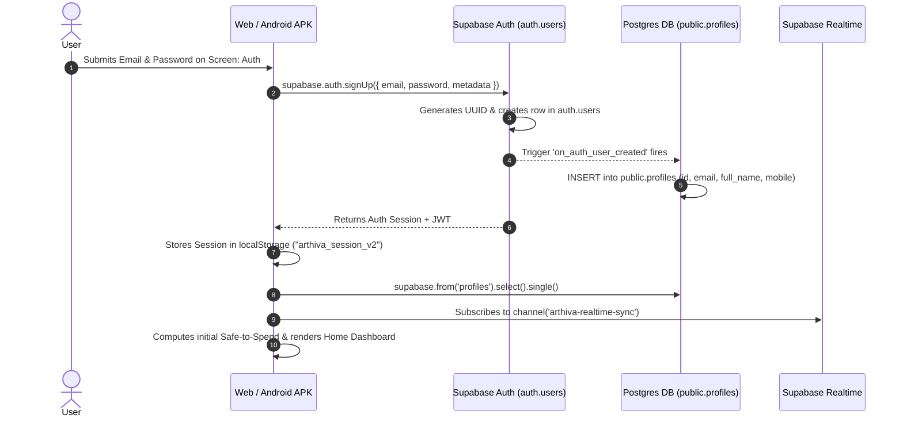

# Arthiva Money — Complete API & Data Operations Documentation

This document provides a comprehensive technical reference for every API call, Supabase database operation, authentication action, real-time sync stream, storage upload, and local-only fallback in **Arthiva Money**.

---

## 📑 Table of Contents
1. [Summary Table of All APIs & Data Operations](#1-summary-table-of-all-apis--data-operations)
2. [Database Schema & Row Level Security (RLS)](#2-database-schema--row-level-security-rls)
3. [Environment Variables Reference](#3-environment-variables-reference)
4. [Step-by-Step New User Lifecycle Flow](#4-step-by-step-new-user-lifecycle-flow)
5. [Detailed API Reference by Feature](#5-detailed-api-reference-by-feature)
   - [5.1 User Authentication & Session Management](#51-user-authentication--session-management)
   - [5.2 User Profile & Pay Cycle Settings](#52-user-profile--pay-cycle-settings)
   - [5.3 Commitments & Bills](#53-commitments--bills)
   - [5.4 Expenses & Quick Log (Single & Split)](#54-expenses--quick-log-single--split)
   - [5.5 Savings Goals & Milestones](#55-savings-goals--milestones)
   - [5.6 Category Budgets & Pacing](#56-category-budgets--pacing)
   - [5.7 Bank Statement Import & Supabase Storage](#57-bank-statement-import--supabase-storage)
   - [5.8 Vector PDF Report Export](#58-vector-pdf-report-export)
   - [5.9 Realtime Replication & Offline Sync Engine](#59-realtime-replication--offline-sync-engine)
6. [Audit of Local-Only / Mock Features](#6-audit-of-local-only--mock-features)

---

## 1. Summary Table of All APIs & Data Operations

| # | Action Name | Trigger / Screen | API / Method | Operation | Supabase Table / Storage | RLS Policy Applied |
|---|-------------|------------------|--------------|-----------|--------------------------|--------------------|
| 1 | User Sign Up | Screen: Auth → Create Account | `supabase.auth.signUp()` | Auth / Create | `auth.users`, `public.profiles` | Auto-profile trigger (`handle_new_user`) |
| 2 | User Login | Screen: Auth → Sign In | `supabase.auth.signInWithPassword()` | Auth / Read | `auth.users` | Supabase Auth API |
| 3 | User Logout | Screen: Profile → Log Out | `supabase.auth.signOut()` | Auth | Local Session & Cookie | Session clearance |
| 4 | Get Active Session | App Initialization (`DOMContentLoaded`) | `supabase.auth.getUser()` | Auth / Read | `auth.users` | Authenticated Token verification |
| 5 | Fetch All Cloud Data | On Login / Reconnect / Realtime Event | `Promise.all([select(...)])` | Read | `profiles`, `commitments`, `expenses`, `goals`, `budgets` | `Users can manage their own [table]` |
| 6 | Save User Profile | Screen: Profile → Edit / Onboarding | `supabase.from('profiles').update()` | Update | `public.profiles` | `Users can manage their own profiles` |
| 7 | Add Commitment | Screen: Bills → Add Commitment | `supabase.from('commitments').insert()` | Create | `public.commitments` | `Users can manage their own commitments` |
| 8 | Edit Commitment | Screen: Bills → Edit Sheet → Save | `supabase.from('commitments').update()` | Update | `public.commitments` | `Users can manage their own commitments` |
| 9 | Delete Commitment | Screen: Bills → Action Menu → Delete | `supabase.from('commitments').delete()` | Delete | `public.commitments` | `Users can manage their own commitments` |
| 10 | Mark Bill as Paid | Screen: Bills → Tap Checkmark | `supabase.from('commitments').update()` | Update | `public.commitments` | `Users can manage their own commitments` |
| 11 | Quick Log Single Expense | Screen: Home / Plan → + Quick Log | `supabase.from('expenses').insert()` | Create | `public.expenses` | `Users can manage their own expenses` |
| 12 | Quick Log Split Expense | Screen: Quick Log → Split (2 Categories) | `supabase.from('expenses').insert()` (×2) | Create | `public.expenses` | `Users can manage their own expenses` |
| 13 | Delete Expense | Screen: Plan → Expense Item → Delete | `supabase.from('expenses').delete()` | Delete | `public.expenses` | `Users can manage their own expenses` |
| 14 | Create Savings Goal | Screen: Home / Plan → Add Goal | `supabase.from('goals').insert()` | Create | `public.goals` | `Users can manage their own goals` |
| 15 | Record Goal Contribution | Screen: Goal Details → Record Savings | `supabase.from('goal_contributions').insert()` | Create | `public.goal_contributions` | `Users can manage their own goal_contributions` |
| 16 | Set Category Budget | Screen: Plan → Adjust Limit | `supabase.from('budgets').upsert()` | Upsert | `public.budgets` | `Users can manage their own budgets` |
| 17 | Upload Bank Statement | Screen: Insights → Import Statement | `supabase.storage.from('statements').upload()` | Upload | `storage.objects` (`statements` bucket) | `Users can upload their own statements` |
| 18 | Log Statement Import | Screen: Import Statement Modal | `supabase.from('statement_imports').insert()`| Create | `public.statement_imports` | `Users can manage their own statement_imports` |
| 19 | Realtime Stream | Background WebSocket Listener | `supabase.channel().on('postgres_changes')` | Realtime | `commitments`, `expenses`, `goals`, `budgets`, `profiles` | PostgreSQL Publication (`supabase_realtime`) |
| 20 | Flush Offline Queue | Background (`window.addEventListener('online')`) | `supabase.from(tbl).[insert/update/delete]()`| Batch Sync | Queued Target Tables | Matches specific entity RLS policy |
| 21 | Export PDF Report | Screen: Insights / Profile → Export PDF | Local Vector Engine (`buildMultiPageVectorPDF`)| Read (Client) | None (Reads local reactive state) | N/A (In-memory binary generator) |

---

## 2. Database Schema & Row Level Security (RLS)

All tables reside in the `public` schema. Every table references `auth.users(id)` via `user_id` (or `id` for `profiles`) with `ON DELETE CASCADE`.

### 2.1 Schema Definition Table
```sql
-- 1. PROFILES
CREATE TABLE public.profiles (
  id UUID PRIMARY KEY REFERENCES auth.users(id) ON DELETE CASCADE,
  email TEXT,
  full_name TEXT DEFAULT 'User',
  mobile TEXT,
  city TEXT DEFAULT 'Bengaluru',
  role TEXT DEFAULT 'Professional',
  payday_day INT DEFAULT 1,
  take_home NUMERIC(12, 2) DEFAULT 50000,
  employer_bank TEXT DEFAULT 'Salary Account',
  current_balance NUMERIC(12, 2) DEFAULT 0,
  household_name TEXT DEFAULT 'My Household',
  household_mode TEXT DEFAULT 'Individual',
  created_at TIMESTAMPTZ DEFAULT NOW(),
  updated_at TIMESTAMPTZ DEFAULT NOW()
);

-- 2. COMMITMENTS & BILLS
CREATE TABLE public.commitments (
  id UUID PRIMARY KEY DEFAULT gen_random_uuid(),
  user_id UUID NOT NULL REFERENCES auth.users(id) ON DELETE CASCADE,
  name TEXT NOT NULL,
  category TEXT NOT NULL,
  amount NUMERIC(12, 2) NOT NULL,
  due_date DATE NOT NULL,
  method TEXT DEFAULT 'UPI',
  status TEXT DEFAULT 'upcoming', -- 'upcoming', 'paid', 'due', 'risk', 'scheduled'
  recurrence TEXT DEFAULT 'Monthly',
  is_at_risk BOOLEAN DEFAULT FALSE,
  has_grace_period BOOLEAN DEFAULT FALSE,
  grace_period_end_date DATE,
  paid_date DATE,
  notes TEXT,
  created_at TIMESTAMPTZ DEFAULT NOW(),
  updated_at TIMESTAMPTZ DEFAULT NOW()
);

-- 3. EXPENSES (Flexible Spending)
CREATE TABLE public.expenses (
  id UUID PRIMARY KEY DEFAULT gen_random_uuid(),
  user_id UUID NOT NULL REFERENCES auth.users(id) ON DELETE CASCADE,
  category TEXT NOT NULL,
  amount NUMERIC(12, 2) NOT NULL,
  merchant TEXT,
  date DATE NOT NULL DEFAULT CURRENT_DATE,
  note TEXT,
  source TEXT DEFAULT 'Manual',
  created_at TIMESTAMPTZ DEFAULT NOW()
);

-- 4. SAVINGS GOALS
CREATE TABLE public.goals (
  id UUID PRIMARY KEY DEFAULT gen_random_uuid(),
  user_id UUID NOT NULL REFERENCES auth.users(id) ON DELETE CASCADE,
  title TEXT NOT NULL,
  target_amount NUMERIC(12, 2) NOT NULL,
  current_saved NUMERIC(12, 2) DEFAULT 0,
  target_date DATE NOT NULL,
  monthly_allocation NUMERIC(12, 2) DEFAULT 0,
  saved_this_cycle NUMERIC(12, 2) DEFAULT 0,
  frequency TEXT DEFAULT 'Monthly',
  linked_account TEXT,
  celebrated_milestone INT DEFAULT 0,
  created_at TIMESTAMPTZ DEFAULT NOW(),
  updated_at TIMESTAMPTZ DEFAULT NOW()
);

-- 5. GOAL CONTRIBUTIONS
CREATE TABLE public.goal_contributions (
  id UUID PRIMARY KEY DEFAULT gen_random_uuid(),
  goal_id UUID NOT NULL REFERENCES public.goals(id) ON DELETE CASCADE,
  user_id UUID NOT NULL REFERENCES auth.users(id) ON DELETE CASCADE,
  amount NUMERIC(12, 2) NOT NULL,
  date DATE NOT NULL DEFAULT CURRENT_DATE,
  note TEXT,
  created_at TIMESTAMPTZ DEFAULT NOW()
);

-- 6. BUDGETS (Category Pacing Caps)
CREATE TABLE public.budgets (
  id UUID PRIMARY KEY DEFAULT gen_random_uuid(),
  user_id UUID NOT NULL REFERENCES auth.users(id) ON DELETE CASCADE,
  category TEXT NOT NULL,
  spending_limit NUMERIC(12, 2) NOT NULL,
  icon TEXT DEFAULT 'tag',
  created_at TIMESTAMPTZ DEFAULT NOW(),
  updated_at TIMESTAMPTZ DEFAULT NOW(),
  UNIQUE(user_id, category)
);

-- 7. BALANCE LOGS (Audit History)
CREATE TABLE public.balance_logs (
  id UUID PRIMARY KEY DEFAULT gen_random_uuid(),
  user_id UUID NOT NULL REFERENCES auth.users(id) ON DELETE CASCADE,
  previous_balance NUMERIC(12, 2) NOT NULL,
  new_balance NUMERIC(12, 2) NOT NULL,
  change_amount NUMERIC(12, 2) NOT NULL,
  reason TEXT,
  source TEXT DEFAULT 'Manual check-in',
  notes TEXT,
  created_at TIMESTAMPTZ DEFAULT NOW()
);

-- 8. STATEMENT IMPORTS
CREATE TABLE public.statement_imports (
  id UUID PRIMARY KEY DEFAULT gen_random_uuid(),
  user_id UUID NOT NULL REFERENCES auth.users(id) ON DELETE CASCADE,
  file_name TEXT NOT NULL,
  file_url TEXT,
  transactions_count INT DEFAULT 0,
  imported_at TIMESTAMPTZ DEFAULT NOW()
);
```

### 2.2 Row Level Security (RLS) Policies
Each table has RLS strictly enforced:
- **Profiles**: `CREATE POLICY "Users can manage their own profiles" ON public.profiles FOR ALL USING (auth.uid() = id) WITH CHECK (auth.uid() = id);`
- **Entity Tables (`commitments`, `expenses`, `goals`, `goal_contributions`, `budgets`, `balance_logs`, `statement_imports`)**:
  `CREATE POLICY "Users can manage their own [table]" ON public.[table] FOR ALL USING (auth.uid() = user_id) WITH CHECK (auth.uid() = user_id);`
- **Storage Bucket (`statements`)**:
  - `INSERT`: Restricted to `auth.uid()::text = (storage.foldername(name))[1]`
  - `SELECT`: Restricted to `auth.uid()::text = (storage.foldername(name))[1]`

---

## 3. Environment Variables Reference

| Variable Name | Client Injection Target | Usage | Required / Optional |
|---|---|---|---|
| `SUPABASE_URL` | `window.__ENV_SUPABASE_URL` | Endpoint URL of the Supabase project | Required |
| `SUPABASE_ANON_KEY` | `window.__ENV_SUPABASE_ANON_KEY`| Client-safe public Anonymous key | Required |
| `VITE_SUPABASE_URL` | Vercel Deployment build env | Reused by CI/CD during web build | Required (Vercel) |
| `VITE_SUPABASE_ANON_KEY` | Vercel Deployment build env | Reused by CI/CD during web build | Required (Vercel) |

> ⚠️ **Security Guarantee:** The Supabase `SERVICE_ROLE` secret is **NEVER** present or referenced in client-side code, GitHub Actions runners, or APK binaries. All access is mediated by user-scoped JWT tokens verified by RLS policies.

---

## 4. Step-by-Step New User Lifecycle Flow



1. **User Action**: Enters Email & Password on `Screen: Auth`.
2. **Auth Call**: `window.ArthivaSupabase.signUp(email, password, { full_name, mobile })`.
3. **Database Trigger**: Supabase executes `handle_new_user()` inside Postgres, instantly creating the corresponding row in `public.profiles` matching `auth.uid()`.
4. **Session Persistence**: Session stored in `localStorage` under `supabase.auth.token`.
5. **Realtime Hook**: App joins channel `arthiva-realtime-sync` listening to all changes on `public`.

---

## 5. Detailed API Reference by Feature

### 5.1 User Authentication & Session Management

#### `supabase.auth.signUp()`
- **Trigger**: Screen: Auth → `btn-welcome-get-started` → `submitAuthContinueToOtp()` / Credentials form.
- **File & Function**: [`supabase.js`](file:///C:/Users/Adminstartor/.gemini/antigravity/scratch/arthiva-money/Arthiva/supabase.js) → `window.ArthivaSupabase.signUp()`
- **Request**:
  ```json
  {
    "email": "user@example.com", // string, required
    "password": "SecurePassword123!", // string, required
    "options": {
      "data": { "full_name": "Rashika", "mobile": "9845012345" }
    }
  }
  ```
- **Response**: `{ data: { user: { id: "a1b2...", email: "..." }, session: { access_token: "..." } }, error: null }`
- **Error Handling**: Displays inline error banner inside `auth-otp-error`.

#### `supabase.auth.signInWithPassword()`
- **Trigger**: Screen: Auth → I already have an account → Enter credentials.
- **File & Function**: [`supabase.js`](file:///C:/Users/Adminstartor/.gemini/antigravity/scratch/arthiva-money/Arthiva/supabase.js) → `window.ArthivaSupabase.signIn()`
- **Request**: `{ "email": "user@example.com", "password": "..." }`
- **Response**: `{ data: { user: {...}, session: {...} }, error: null }`
- **Side Effects**: Triggers `syncAllDataFromSupabase()`, populates state, redirects to `switchScreen("home")`.

---

### 5.2 User Profile & Pay Cycle Settings

#### `supabase.from('profiles').update()`
- **Trigger**: Screen: Profile → Save Changes, or Onboarding Completion.
- **File & Function**: [`supabase.js`](file:///C:/Users/Adminstartor/.gemini/antigravity/scratch/arthiva-money/Arthiva/supabase.js) → `window.ArthivaSupabase.updateRecord("profiles", userId, payload)`
- **Request**:
  ```json
  {
    "full_name": "Rashika Padmanaban", // string, optional
    "city": "Bengaluru", // string, optional
    "payday_day": 1, // integer (1-31), required
    "take_home": 50000.00, // numeric, required
    "current_balance": 32000.00, // numeric, optional
    "employer_bank": "HDFC Bank" // string, optional
  }
  ```
- **Response**: `{ data: [...], error: null }`
- **Side Effects**: Recalculates pay cycle context (`cycleStart`, `cycleEnd`, `daysLeft`), updates Home header ribbon and Safe-to-Spend baseline.

---

### 5.3 Commitments & Bills

#### `supabase.from('commitments').insert()`
- **Trigger**: Screen: Bills (Activity) → `+ Add Commitment` Modal → Save button.
- **File & Function**: [`supabase.js`](file:///C:/Users/Adminstartor/.gemini/antigravity/scratch/arthiva-money/Arthiva/supabase.js) → `window.ArthivaSupabase.insertRecord("commitments", payload)`
- **Request**:
  ```json
  {
    "name": "House Rent", // string, required
    "category": "Rent", // string, required
    "amount": 20000.00, // numeric > 0, required
    "due_date": "2026-11-02", // date string (YYYY-MM-DD), required
    "method": "UPI", // string ('UPI', 'Auto-debit', 'Card Recurring')
    "status": "upcoming", // string ('upcoming', 'paid', 'due', 'risk')
    "notes": "Indiranagar Flat rent" // string, optional
  }
  ```
- **Response**: Returns newly created row with generated UUID.
- **Side Effects**: 
  - Immediately recalculates `Safe to Spend` (`balance - billsBeforePayday - goals`).
  - Broadcasts Realtime event to other open devices.
  - Dynamically computes status (`Paid`, `Due`, `Risk`, `Scheduled`) based on current date.

#### `supabase.from('commitments').update()` (Mark Paid / Edit)
- **Trigger**: Screen: Bills → Tap Checkmark to mark Paid, or edit sheet.
- **Request**: `{ "status": "paid", "paid_date": "2026-10-25" }`
- **Side Effects**: Removes amount from `billsBeforePayday`, increments `paidBillsThisCycle`, recalculates Safe-to-Spend upward.

---

### 5.4 Expenses & Quick Log (Single & Split)

#### `supabase.from('expenses').insert()`
- **Trigger**: Screen: Plan or Floating Action Button → `+ Quick log` → `submitQuickExpense()`
- **File & Function**: [`app.js`](file:///C:/Users/Adminstartor/.gemini/antigravity/scratch/arthiva-money/Arthiva/app.js) → `submitQuickExpense()`, calling `window.ArthivaSupabase.insertRecord("expenses", payload)`
- **Request (Single Mode)**:
  ```json
  {
    "category": "Groceries and daily essentials", // string, required
    "amount": 420.00, // numeric > 0, required
    "merchant": "Blinkit", // string, optional
    "date": "2026-10-25", // date, defaults to today
    "note": "Milk and fruits", // string, optional
    "source": "Manual"
  }
  ```
- **Request (Split Mode)**:
  Executes two discrete inserts linked via note tag `(Split 1/2)` and `(Split 2/2)`.
- **Side Effects**:
  - Immediately updates "Spent this cycle" row in Safe to Spend Breakdown.
  - Deducts from `Safe to Spend` and category budget bar.
  - If Safe to Spend becomes negative, updates per-day line to `"You're ₹X short this cycle"`.

---

### 5.5 Savings Goals & Milestones

#### `supabase.from('goals').insert()`
- **Trigger**: Screen: Plan → Goals Widget → `+ Add New Goal`
- **File & Function**: [`supabase.js`](file:///C:/Users/Adminstartor/.gemini/antigravity/scratch/arthiva-money/Arthiva/supabase.js) → `window.ArthivaSupabase.insertRecord("goals", payload)`
- **Request**:
  ```json
  {
    "title": "Goa trip with friends", // string, required
    "target_amount": 40000.00, // numeric, required
    "current_saved": 15000.00, // numeric, required
    "target_date": "2027-03-31", // date, required
    "monthly_allocation": 5000.00 // numeric, required
  }
  ```
- **Side Effects**: Ring-fences `monthly_allocation` from the current cycle's Safe to Spend allowance.

---

### 5.6 Category Budgets & Pacing

#### `supabase.from('budgets').upsert()`
- **Trigger**: Screen: Plan → Edit Category Pacing Limit
- **Request**: `{ "category": "Dining out and food ordering", "spending_limit": 5000.00, "icon": "utensils" }`
- **Side Effects**: Re-renders progress bars and budget utilization percentage on Insights screen (`ins-budget-util-val`).

---

### 5.7 Bank Statement Import & Supabase Storage

#### `supabase.storage.from('statements').upload()`
- **Trigger**: Screen: Insights → Import Statement Modal → Select PDF/CSV → Tap `Process statement`
- **File & Function**: [`supabase.js`](file:///C:/Users/Adminstartor/.gemini/antigravity/scratch/arthiva-money/Arthiva/supabase.js) → `window.ArthivaSupabase.uploadStatement(file)`
- **Storage Target**: Bucket: `statements`, Object Path: `${user.id}/${Date.now()}_${file.name}`
- **Database Entry**: Inserts audit log into `public.statement_imports` with filename and extracted transaction count.
- **Client Security**: Validates that statement is password-unprotected before upload (`detectIfPdfIsProtected()`).

---

### 5.8 Vector PDF Report Export

#### Binary Vector PDF Engine
- **Trigger**: Screen: Insights / Profile → Tap `Export PDF` button (`exportDataPDF(this)`).
- **File & Function**: [`app.js`](file:///C:/Users/Adminstartor/.gemini/antigravity/scratch/arthiva-money/Arthiva/app.js) → `buildMultiPageVectorPDF(fin, data, user)`
- **Execution**:
  - Pure client-side binary PDF generator.
  - Queries active financial metrics from state (`calculateFinancials()`).
  - Generates A4 vector PDF with two full pages (Page 1: Executive Summary & Charts; Page 2: Outflow Audit Ledger & Commitments Schedule).
  - In Web: Triggers browser blob download `Arthiva-Money-Report-<Month-YYYY>.pdf`.
  - In Android APK: Uses `@capacitor/filesystem` and `@capacitor/share` to write directly to phone Documents and open native Android share sheet.

---

### 5.9 Realtime Replication & Offline Sync Engine

#### Realtime Subscription
- **Channel**: `arthiva-realtime-sync`
- **Event**: `*` on schema `public`
- **Action**: When a change occurs on any device, `syncAllDataFromSupabase(true)` triggers silently, reconciling records without disturbing active UI focus.

#### Offline Queue Replay
- When `navigator.onLine === false`: All inserts/updates/deletes are intercepted and appended to `localStorage` key `arthiva_offline_queue_v1`.
- When `online` event fires: `flushOfflineQueue()` iterates sequentially, replays operations to Supabase with user authentication tokens, and purges the local queue.

---

## 6. Audit of Local-Only / Mock Features

The following features currently utilize local sandboxed execution or client-side storage rather than cloud Supabase endpoints:

1. **App-Lock PIN & Password**:
   - *Current Implementation*: Stored in `localStorage` under `arthiva_money_app_state_v2.security`.
   - *Status*: Device-specific privacy measure by design (each phone can have its own PIN).
2. **Account Aggregator / SMS / Gmail Parser Sandbox**:
   - *Current Implementation*: Located in `ArthivaState.autoTracking`.
   - *Status*: Regulatory compliance mock interface (Reserve Bank of India Account Aggregator simulator).
3. **Previous Cycle Historical Baseline**:
   - *Current Implementation*: `ArthivaState.previousCycleData`.
   - *Status*: Pre-populated seed used for delta comparisons on brand new accounts. Once a user completes their first month, real data from `expenses` and `commitments` replaces it.
4. **Theme (Light / Dark) & Workbench Zoom**:
   - *Current Implementation*: Stored in `localStorage` (`data-theme`, `arthiva_wb_toolbar_visible`).

---

*Documentation maintained for Arthiva Money. All schemas, functions, and endpoints comply with Supabase RLS and client-side zero-leakage standards.*
